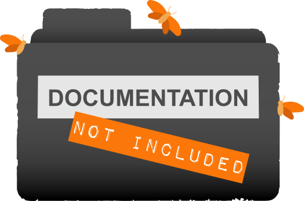

<div align="center">



# DNI Stream website

The website of DNI Stream and its podcast, **Documentation Not Included**.

<a href="https://dnistream.live"></a>

**Project**<br>
<a href="https://github.com/DNIStream/dni.website/actions/workflows/site.yml"></a>
<a href="https://github.com/DNIStream/dni.website/tags"></a>
<a href="https://github.com/DNIStream/dni.website/commits/master"></a>
<a href="https://github.com/DNIStream/dni.website/issues"></a>
<a href="LICENSE"></a>

**Built with**<br>
<a href="https://nodejs.org/"></a>
<a href="https://www.11ty.dev/"></a>
<a href="docker/nginx.conf"></a>
<a href="tests/e2e"></a>

**Listen and join in**<br>
<a href="https://podcasts.apple.com/gb/podcast/documentation-not-included/id1468075833"></a>
<a href="https://open.spotify.com/show/21KuGIBltgawtEqlXHSuGd"></a>
<a href="https://feeds.fireside.fm/dnistream/rss"></a>
<a href="https://discord.gg/KsCt2hx"></a>

</div>

---

Hosted by [Chris Sebok](https://github.com/Bidthedog) and [Josey Howarth](https://github.com/sudomistress).

It is a static site: Eleventy builds it from `site/` into `dist/`, and one small nginx container
serves it. Episode pages are generated from the podcast's RSS feed.

## Prerequisites

- Node.js 24
- Docker, for the container and the E2E tests

## Build and preview

```sh
npm ci
npm run build              # builds dist/; set FEED_OFFLINE=1 to use the committed feed snapshot
npm run serve              # live-reloading preview on http://localhost:8080
```

## Run it in its container

```sh
npm run container:up       # builds the image and starts it on http://localhost:8080
npm run container:stats    # image size, memory, CPU, user, port and health
npm run container:down
```

`SITE_PORT` changes the port. The container runs as it will in production: read-only, as a
non-root user, limited to 48 MB of memory and a quarter of a CPU.

## Test

```sh
npm run test:unit
npm run test:build         # checks dist/, so build first
npm run test:e2e           # builds the image, runs it with production limits, then Playwright
npm run test:e2e -- tests/e2e/archive.spec.js    # one spec
```

`test:e2e` finishes by failing if the image is 30 MB or more, the running container uses 48 MB of
memory or more, or the server runs as root.

## Podcast episodes

The episode pages are built from the podcast feed. Each build reads the live feed and falls back to
the committed snapshot, `site/_data/feed-snapshot.xml`, if the feed cannot be read. After publishing
an episode, update the snapshot and commit it:

```sh
npm run feed:refresh       # never replaces the snapshot with a feed holding fewer episodes
```
